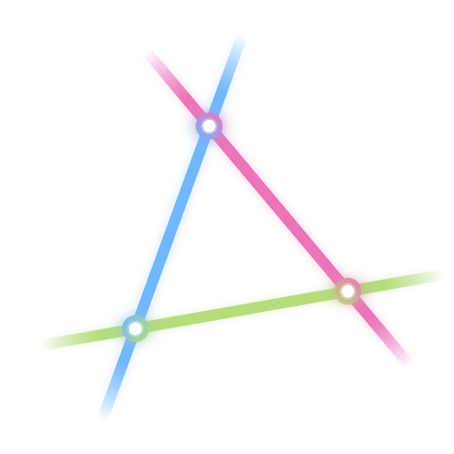

[Open the simulation](https://aryayae.com/ek-nakajima-quiver-varieties/)

<div align="center">



# E_k Nakajima Quiver Varieties

An interactive explorer of four-dimensional ALE spaces of type E6, E7 and E8.

[](LICENSE)

</div>

This browser app explores Nakajima quiver varieties $M(v,w)$ for affine
ADE quivers, with dimension vector $v=\delta$ (the null root) and
one-dimensional framing at a node of mark one. The dimension formula gives

$$\dim_{\mathbb H}M(\delta,w)=\sum_i\delta_iw_i=1.$$

At regular levels these hyperkähler spaces are the minimal resolutions of
$\mathbb C^2/\Gamma$, where $\Gamma$ is the binary tetrahedral (E6),
octahedral (E7), or icosahedral (E8) subgroup of $\mathrm{SU}(2)$.
Their compact cores contain six, seven, or eight exceptional spheres,
meeting according to the finite Dynkin tree.

## Run

From the repository root:

```bash
python3 -m http.server 8000
```

Open <http://localhost:8000/>. The app requires HTTP. The downloadable
[single HTML file](ek-nakajima.html) includes the widget modules and assets;
serve it over HTTP too. MathJax typesetting uses a CDN.

For embedding, use `?bare&theme=light` (or `dark`) to hide the standalone
header, theme button and footer while retaining the widget introduction.
The iframe accepts `{type: "ek-nakajima-theme", theme: "light" | "dark"}`
from its parent origin and reports `{type: "ek-nakajima-height", height: number}`
when its content size changes. Preserve the parent referrer so the iframe can
identify that origin. Run `node tests/validate-embed.mjs` to check the bridge.

## Explore

Switch between E6, E7 and E8 using the tabs. The core portrait shows the
exceptional spheres and a movable marker. In E6, the flag-incidence view,
core portrait and complex arrow matrices share the same controls:

- `r` and `theta` select the position along a sphere. On the central chart,
  `z = r/(1-r) exp(i theta)`; `r=1` is infinity.
- `t` and `phi` control the transverse cotangent direction. Limit buttons
  move between supported sphere charts and exterior tips.
- The Parameters panel changes the six beta levels and sphere areas.
  Reach a positive-beta wall, select Cross Wall, then drag into the adjacent
  chamber. Coordinate-zero walls remain locked.
- The **y data** toggle shows cotangent blocks on the flags. Branch matrix
  cards support selecting entries and copying matrices.

E6 uses numerically balanced representatives, with real and complex
moment-map residual checks before displaying new matrices. It includes
central and arm charts, certified canonical attachment points, and
supported chamber transport. E7 has a numerically balanced central-sphere
flag and matrix view; its transverse controls remain under construction.
E8 currently provides the core portrait.

In E6, sphere areas determine the rendered radii, while the round shapes and
embedding remain schematic. The picture does not reproduce the intrinsic
hyperkähler metric. The flag drawing projects complex incidence into a real
screen image; intersections and colors are visual cues rather than exact
certificates. The atlas has bounded coverage. See
[E6 sphere areas and derivation](docs/e6-sphere-areas.md) and
[chamber transport notes](docs/e6-chamber-transport.md) for details.

## Known issues

**E6 flag display discontinuities.** Points, lines and colors can jump as the
inputs vary continuously. Along regular input families, balanced representatives
can be chosen continuously in a consistent unitary gauge. The documented
flag-display jumps are camera artifacts: repeated camera eigenvalues or
vanishing phase references can abruptly change the displayed frame. They do
not indicate a jump in the underlying moduli point. Raw matrix entries may
also change at chart switches, where the representative's gauge changes.
See the [camera notes](docs/e6-continuous-incidence.md).

## Develop and validate

The widget uses dependency-free JavaScript ES modules and vendored three.js.
The separate Python E6 reference core requires Python 3, numpy, scipy, sympy
and pytest. Its frozen fixture differs from the live browser defaults.

```bash
bash tests/run.sh             # Node widget batteries
node tools/build-single.mjs   # regenerate ek-nakajima.html
cd sim
python -m pytest -q           # Python reference tests
```

See the [test guide](tests/README.md) for battery coverage and diagnostic
exceptions, and [simulation status](sim/STATE.md) for mathematical conventions
and verified, candidate and unsupported results. E7 development is described
in the [open-chart](docs/E7_OPEN_CHART.md) and
[endpoint-chart](docs/E7_ENDPOINT_CHARTS.md) notes.

## Build and deploy

This repository is the source of truth; the author's website carries a
synced copy. Build and inspect the selective hosted package with plain Node:

```bash
node tools/build-site.mjs
node tests/validate-site-package.mjs
python3 -m http.server 8000 --directory _site
```

The build regenerates the single-file download and stages entry pages,
runtime assets and license notices in `_site/`. Source documentation,
simulation code, tests and development previews stay in the repository.

For GitHub Pages, select **Settings > Pages > Build and deployment > Source:
GitHub Actions**, then manually run **Deploy selected website files** from
the Actions tab. That workflow uploads `_site/` and has no push trigger.

By **Arya Yae**. Released under the [MIT License](LICENSE).
Bundled three.js has its own [MIT license](assets/js/ek-nakajima/lib/LICENSE);
see [third-party notices](THIRD_PARTY_NOTICES.txt).
