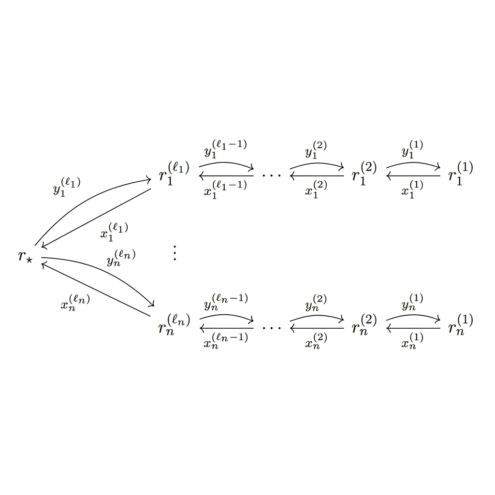

<div align="center">



# E_k Nakajima Quiver Varieties

**An interactive explorer of the four-dimensional Nakajima quiver varieties of affine ADE type — the ALE gravitational instantons.**

[](LICENSE)
[](#tests)

</div>

This repository is a browser-native explorer for the **Nakajima quiver
varieties** $M(v,w)$ attached to the affine ADE quivers of type E6, E7 and E8,
in the case where the dimension vector is the null root $v=\delta$ and the
framing is one-dimensional. The null-root property forces
$\dim_{\mathbb H}M(v,w)=1$, so these are the **four-dimensional ALE
gravitational instantons** — the minimal resolutions of $\mathbb C^2/\Gamma$
for the binary tetrahedral (E6), octahedral (E7) and icosahedral (E8)
subgroups of $\mathrm{SU}(2)$.

> **Status.** The E6 flag picture and matrix readout use numerically balanced representatives at the selected beta parameters. A background worker solves the real moment maps before displaying new matrices. A stateless tensor camera displays the balanced flags and their cotangent data, with visibility following actual map ranks. E7/E8 remain portrait-only; atlas coverage and global continuity are not claimed.

## Try it

| | |
|---|---|
| **Single file** | Download [`ek-nakajima.html`](ek-nakajima.html) — everything inlined, works offline when opened over HTTP |
| **Local** | `python3 -m http.server 8000` in this folder, then open <http://localhost:8000/> |

The widget is an ES-module app, so it must be served over **HTTP**, not opened
directly as a `file://` path. The single-file build inlines all modules, but
browsers still restrict module scripts on `file://`.

## What you are looking at

Take the **affine ADE quiver** $\widehat Q$ whose underlying graph is the
affine Dynkin diagram of type E6, E7 or E8, with dimension vector
$v=\delta$ (the marks) and a one-dimensional framing $w=e_j$ at a node of
mark $1$. Deleting the **affine node** leaves the **finite** Dynkin tree,
whose nodes index the exceptional $\mathbb P^1$'s of the **core** of the
ALE space:

- six spheres for E6 (a trivalent junction),
- seven for E7,
- eight for E8;

meeting transversally at points dual to the Dynkin edges, with the deleted
affine node the noncompact end where the framing lives.

The widget draws this core as an externally tangent packing of spheres and
lets you move a marker through the normal directions with the same
$(r,\theta,t,\phi)$ interaction as the hyperpolygon side view. Tabs switch
between E6, E7 and E8.

The E6 incidence and moduli views appear together, with the complex arrow matrices above them. Shared controls use

$$z=\frac{r}{1-r}e^{i\theta},\qquad 0\leq r\leq1.$$

Thus `r=1` is infinity, and concurrency occurs at `r=1/2, theta=0`.
The compact central chart moves the first line with
`A1=[e1,(1-r)e2+r exp(i theta)e3]`; the controls set
`eta=t/(1-t) exp(i phi)`. These are input complex-gauge representatives.
`balanced-model.js` solves their real moment maps with checked residuals,
using exact bounded overlap representatives near the three arm limits.
Continuation seeds are reused within a chart family, with a cold fallback.
The optimizer checks its cached residual before building another Jacobian,
stopping when both existing absolute and relative acceptance bars are met.
Final complex-equation, positivity, and gauge checks still run.
Exact solve-local caches reuse unchanged log-gauge block exponentials and
inverses across finite-difference evaluations; this does not alter tolerances.
Only successful solves reach the matrix readout; dragging coalesces pending
requests and displays validated intermediate results while the newest solve
is pending. Matrices remain visible during solving. Only the newest result
marks the current parameters balanced; tab changes invalidate intermediate
updates too. The generated worker is included
in both the modular app and standalone HTML.
The readout uses three fixed-height branch cards, with selectable matrix
entries, horizontal scrolling, and per-branch copying. Cards stack on narrow
hosts without changing height as values update. Newly gained dot/line or
point coincidences and collinearity pulse the affected dots for 750 ms;
new concurrence pulses its common marker. Unchanged incidences do not pulse.
The sliders snap to the three radial attachments and zero phase. A monotone,
continuously differentiable magnet eases into a small exact plateau. The thumb
keeps its raw position so dragging and keyboard steps can leave the plateau;
the readout, balanced solve, and both views share the mapped coordinate. The limit
buttons give one-sphere outward/inward navigation in the core portrait.
The E6 t slider stops at readout 99 (compact coordinate .99) when its current
path has no supported infinity endpoint; exact incoming branch limits retain
compact coordinate 1 and the infinity readout. Outgoing paths use the finite cap.
All E6 sphere intersections and exterior tips carry explicit C* grading
witnesses. Sphere radii, angles and the rendered motion remain schematic;
the implementation does not claim a global stable atlas. Unsupported charts clear
the matrix readout instead of leaving matrices from a different point visible.
The flag panel records the forward-arrow flags, with plane labels P1/P2/P3
and unlabelled marked points. Its top-left "y data" toggle starts checked.
When enabled, three fixed-length 16px arrows
show the three intrinsic blocks of `K_i=A_i B_i` in the orthogonal flag
decomposition. Opacity follows the physical block magnitude; hue and saturation
follow a continuous complex correlation with the other balanced tensors. The `c12`
arrow is tangential toward the marked point; `c13` is normal toward it;
`c23` is normal toward the projected orthogonal direction in the flag plane.
That target is the orthogonal complement of the marked point within its flag
plane, equivalent projectively to removing the point component from an
independent column of balanced `A_i`. The schematic projects this direction
onto the corresponding displayed line. A vanishing phase correlation turns an
arrow gray while its nonzero physical magnitude stays visible. Zero blocks are
hidden. Screen arrows are schematic matrix blocks, not literal displacements
in complex projective space. The continuously oriented line fixes arrow sides;
the two normal arrows occupy opposite sides. The full reverse arrows remain
visible in the matrix readout.

At the concurrency attachment (`r=1/2`, `theta=0`), the first outward limit
has a concrete E6 representation. Its next chart is obtained from the coupled
limit `z=1+v/lambda^2`, `w=lambda`, after a complex gauge change. Writing
`L=(1,1,1)`, `p_i=e_i-L/3`, and
`ell_1=(0,-1,1)`, `ell_2=(1,0,-1)`, `ell_3=(-1,1,0)`, its arrows are
`a_i=e1`, `A_i=[p_i,L]`, `b_i=(0,v)`, `B_i=[v L^T/3; ell_i]`.
The point `v=0` is the fixed-point limit; finite complex `v` extends beyond
that point. The E6 portrait places the single-sphere arm at this concurrency
attachment, with two spheres on each endpoint arm. The limit button enters
the outgoing paraboloid at the short arm's tip, rather than a second sphere.
The new chart satisfies the complex equations; stability throughout the chart
and the metric interpretation of its portrait coordinates are not certified.

The live incidence view is a stateless, gauge-invariant tensor schematic.
Bounded traces of the balanced point and plane projectors determine coordinate
priors and continuously oriented line normals. A strictly positive definite
12-variable fit aligns incidences, equal flags, collinearity and concurrency.
A common smooth bound keeps its geometry inside the panel. This removes the
ordered eigenvectors, phase anchoring and affine divisions that caused the
earlier jumps; it uses the same rule throughout the supported chambers.
See [the continuous incidence construction](docs/e6-continuous-incidence.md).

Point visibility follows `||x_i^(2) x_i^(1)||^2`; plane visibility follows
`||wedge^2 x_i^(2)||^2`. Both reach full opacity at weight `.15` (a display
parameter). Thus loss of a plane can leave its marked point visible, and
loss of a marked point can leave its plane visible. A beta approaching zero
does not itself force either to disappear: the actual balanced maps decide.
The coordinate-wall collapse and a positive-beta wall contraction are
numerically tested separately. At the latter, all flags remain visible.

Line phase cues come from complex cyclic traces of the balanced tensors.
Dot hues use the true complex incidence residuals against the other planes;
a matching hue indicates that pairing, while a double match becomes neutral.
Disappearing planes also lose their influence on dot color. These cues are
separate from the cotangent arrows. Nearly incident configurations can have
perceptually indistinguishable hues, so color is not an exact certificate.

The diagram is a continuous schematic, rather than an exact embedding of
complex projective flags in a real affine plane. Fully visible equal objects
match by symmetry; true incidences are fitted to subpixel accuracy. Exact
complex classifications and hues still come from the representation itself.
The construction avoids the old camera singularities, while finite numerical
tests cannot certify every solver input or all floating-point behavior.
Historical camera code remains solely as a regression fixture. No additional
on-page explanation accompanies this change.
The outgoing coordinate has weight two under reverse-arrow scaling:
`v = (t/(1-t))^2 exp(2i phi)`. This preserves the original scaling/phase
meaning of the controls; the outgoing circle action has a half-turn stabilizer.

These charts do not yet represent every complex-gauge class. In particular,
generic fixed `z` does not have a finite `w -> infinity` limit: the invariant
`trace((A_1 B_1)^2 A_2 B_2) = -w^3 z^2 (z-1)^2` diverges away from
`z=0,1`. Additional exceptional charts and their stability/overlap checks
are needed before claiming complete coverage. E7/E8 remain portrait-only.
At the frozen levels `alpha=(3,3,3)`, `gamma=(1,2,3)`, the old compact endpoint
families are unstable for every reverse-arrow amplitude: the central plane
`P_3` defines a subrepresentation with middle dimensions `(1,1,2)` and outer
dimensions `(1,0,1)` at zero or `(0,1,1)` at infinity. Its King weight is
`6+1+2+6-(2/3)*21=1`. The reverse arrows preserve this subrepresentation.
Those old endpoint representatives are not used for further limits. The widget uses the nearby regular levels `gamma=(1,21/10,3)`;
the frozen solver fixture is unchanged. The full bounded-real-root audit finds
four zero-weight roots (two complementary pairs) at the frozen levels and none
at the display levels. The smallest absolute root weight there is `1/15`.

For the zero-side long arm, the replacement chart has
`A1=[e1,e2+z e3]`, `A2=[e2,e1+e3]`, `A3=[e3,e1+e2]` and `a_i=e1`.
Its reverse arrows and the full overlap gauges are in `branch-charts.js`.
The successive coordinates are `(z,w)`, `(s,v)=(1/w,z w^2)`, and
`(h,p)=(1/v,s v^2)`. Their C* weights are `(0,1)`, `(-1,2)`, `(-2,3)`.
The other arm swaps branches 2/3 and central coordinates 2/3, with signed fiber coordinates as specified in `branch-charts.js`. At the infinity pole its local phase is `phi+2 theta`. The second
sphere uses `v=(t/(1-t))^2 exp(2i phi)` and the outgoing tip chart uses
`p=(t/(1-t))^3 exp(3i phi)`. The limit buttons identify precisely equal
canonical matrices at each tip/base. The first climb adds a point-line
incidence; the second completes the coordinate triangle of flag lines.

Fixedness is tested on all arrows: in a supplied integer grading, each
forward arrow has target weight minus source weight zero, and each reverse
arrow has difference one. Hence the grading gauge sends `(x,y)` to
`(x,lambda*y)` for every nonzero complex `lambda`. Zero-section points use
the trivial grading. Stability is a separate King-weight check; fixedness
alone does not establish a valid moduli point.
`stability-certificates.js` independently checks all eight canonical
attachment/intersection/tip configurations using exact integer minors and
rational King weights. Every maximal weight is strictly negative at the
display levels. The old fixture's semistable points are detected by exact
zero weights. This endpoint certification does not claim complete coverage
or stability of every point in every two-dimensional chart.

The compact first-line chart is stable on the whole central sphere by exact
incidence-stratum certificates. Its raw coordinate flags fix three points and
two lines, but these are not the displayed coordinates: balancing and the
unitary camera determine the live picture. The legacy schematic drawing
helpers remain available for regression tests.

## The mathematics

The construction (Nakajima '94) is the quiver analogue of the Kronheimer
ALE construction. With $v=\delta$ the null root, so that
$2\delta_i=\sum_{j\sim i}\delta_j$, the dimension formula gives

$$
\dim_{\mathbb H}M(\delta,w)=\sum_i \delta_i w_i=1
$$

for any framing $w=e_j$ at a mark-$1$ node, hence $M(\delta,w)$ is four real
dimensions. It carries a hyperkähler metric and is the minimal resolution
$\widetilde{\mathbb C^2/\Gamma}$ of the corresponding Kleinian singularity.

## Architecture

The geometry layers are dependency-free ES-module JavaScript; the display
layer uses a vendored three.js only.

| Module | Role |
|---|---|
| `assets/js/ek-nakajima/core-math.js` | Frozen Milestone-0 core ported to JS: dimensions, Hermitian bases, complex/unitary gauge, complex/real moment maps, the 23-coordinate packing, and the V0/V5 geometry. |
| `assets/js/ek-nakajima/solver.js` | The Milestone-2 positive-Hermitian-gauge real-moment-map solver (trust-region LM, Hermitian `expm`), ported from the Python reference. |
| `assets/js/ek-nakajima/element-view.js` | V2: the weighted-flag geometry at `y=0` and its projected su(3) "triangle + flag marker" display data. |
| `assets/js/ek-nakajima/chart.js` | Candidate affine/compact charts and the exact M5 reverse-arrow extension controlled by t and phi. |
| `assets/js/ek-nakajima/limit-chart.js` | Gauge-renormalized concurrency limit and its complex one-parameter family. |
| `assets/js/ek-nakajima/branch-charts.js` | Stable endpoint replacements and two exact overlap charts on each long E6 arm. |
| `assets/js/ek-nakajima/fixed-point.js` | Integer grading witnesses and infinitesimal obstructions to C* fixedness. |
| `assets/js/ek-nakajima/e6-levels.js` | Separate display/fixture levels and the full bounded-real-root wall audit. |
| `assets/js/ek-nakajima/e6-atlas.js` | Pure control-to-chart dispatch, including fixedness guards at intersections and tips. |
| `assets/js/ek-nakajima/stability-certificates.js` | Exact rational King certificates for all eight canonical attachment/intersection/tip fixtures. |
| `assets/js/ek-nakajima/element-model.js` | Pure driver: `solveElement(r, θ, levels, {initialLogGauge})` = chart -> warm-started solve -> element view. |
| `assets/js/ek-nakajima/element-screen.js` | Legacy orthographic projection utility, retained for validation. |
| `assets/js/ek-nakajima/flag-incidence.js` | Complex flag extraction, numerical incidence classification, and real schematic layout. |
| `assets/js/ek-nakajima/flag-diagram.js` | Continuous chart geometry and relative line phase, with reconstruction of the complex parameter from the decorated diagram. |
| `assets/js/ek-nakajima/element-render.js` | Balanced flag diagram with hue indicating cross-incidence; legacy chart phase rendering. |
| `assets/js/ek-nakajima/quiver-data.js` | Per-type affine ADE data: nodes, edges, marks $=\delta$, junction, framing nodes, the finite core tree, and `validateQuiver`. |
| `assets/js/ek-nakajima/tree-embed.js` | Shared pure radial tidy-tree embedding used by both layout layers. |
| `assets/js/ek-nakajima/core-layout.js` | Quiet core-tree layout: a non-overlapping externally-tangent radial packing of the finite Dynkin core. |
| `assets/js/ek-nakajima/diagram-layout.js` | Full affine-diagram layout (tree/cycle). Validated; not currently imported by the widget. |
| `assets/js/ek-nakajima/core-view.js` | The generalized side view: `buildSideLayout`, the Node-safe `coreFlow`, and the browser `makeCoreView` three.js factory. |
| `assets/js/ek-nakajima/representation-readout.js` | Live complex x and y arrow matrices for all three branches. |
| `assets/js/ek-nakajima/widget.js` | Simultaneous incidence and moduli views with shared compact coordinates. |
| `assets/js/hyperpolygon/sideview-shared.js` | The flow constants and vector helpers shared with the hyperpolygon side view (imported unchanged). |
| `assets/js/ek-nakajima/lib/` | Vendored `three.min.js` and `OrbitControls.js`. |

## Tests

The repository ships the Node validation harness for the geometry layers. It
has no dependencies and runs on plain Node.

```bash
bash tests/run.sh    # validate-data, validate-layout, validate-diagram
```

The batteries assert the arithmetic that makes the views trustworthy: the
affine Cartan condition, the unique junction and finite-tree structure, the
dimension count $\dim_{\mathbb H}M=1$ at every framing node, external
tangency of the whole core packing, and the diagram layout invariants. See
[`tests/README.md`](tests/README.md).

### Single-file build

```bash
node tools/build-single.mjs   # regenerates ek-nakajima.html from index.html
```

## Updates

This repository is intended to be the **source of truth** for the E_k
Nakajima widget modules and batteries (mirroring the hyperpolygon setup). A
copy on the author's personal website is a downstream mirror synced from
here.

## Author

**Arya Yae** — questions, corrections and pull requests welcome.

## License

Released under the [MIT License](LICENSE). The bundled `three.js` is under its
own MIT license (see `assets/js/ek-nakajima/lib/`).

The y arrows use darker strokes and a short smooth opacity fade near zero
magnitude: half opacity at .025 and full opacity from .05 onward.

## E6 beta parameters and sphere areas

The Parameters panel uses the real coefficients of the paper's compact
levels: write `a_i = beta_i^(1)`, `g_i = beta_i^(2)`, and
`T = sum_i(a_i + 2*g_i)`. The Hermitian solver levels are **twice** these
beta values. The live default beta pairs are `(1.23,.40), (1.64,1.41), (1.06,1.82)`.
They remain in the reference chamber, with distinct coordinates and a unique
root wall at every single-slider boundary. The original regular fixture
remains the independent chamber reference used by exact numerical regressions.
All six sliders update the balanced representation. Same-chart beta changes
reuse the previous balancing gauge and retain the incidence frame while a
new solve is pending. If the ordinary solve fails near a wall, a recovery
solve uses an analytic Jacobian and QR least squares with weaker damping.
If that also fails, a cold solve follows a sequence of real levels from the
regular reference, rebasing the same complex orbit on each balanced result.
The final result satisfies the requested levels with unchanged real and
complex residual acceptance criteria. Difficult
cold wall approaches can take several seconds. Red boundaries show
nearest root walls; input is clipped strictly inside the current chamber.
With fixed moduli coordinates, beta updates balance directly from the previous
balanced representative. This avoids a poorly conditioned solve in the
original chart near a collapsing sphere. Analytic derivatives share a cached
eigensystem per gauge block. Continuation and cold solves are checked against
the same residual tolerances and rendered-data comparisons.
All five positive-beta facets of the initial chamber support crossing, as do
positive-beta facets reached by subsequent crossings. Each chamber inequality
has its own row and Cross Wall button. Buttons enable at their corresponding
boundaries; coordinate-zero buttons remain disabled.
Clicking retains beta and the dot coordinates, changes the selected chamber,
and allows dragging farther or crossing back. For example, increase
beta_1^(1) from its default 1.23 to its boundary near 1.65. Coordinate-zero walls remain
locked; there is no two-dimensional chamber view yet.
At the boundary, rendering uses an interior sample with crossed period at
least `1e-7`; requested and displayed levels are separate DOM metadata.
This is a numerical wall-limit approximation, not an exact singular solve.

Adjacent representations use balanced reflection transport with independent
real/complex residual checks. Ordered curve periods follow the same transport;
for the original r=0 crossing the two affected classes change as
`c -> -c`, `b -> b+c` (second and first spheres respectively).
Worker epochs reject results and seeds from the previous chamber. See
[wall controls](docs/e6-wall-controls.md) for scope and validation.

In the initial chamber the following periods are the symplectic areas
**divided by 2*pi**, with first/second counted outward from the central sphere:

| Component | Area / (2*pi) | Original reference fixture |
| --- | --- | --- |
| Central | `g_1` | `1/2` |
| r=0, first | `T/3 - a_2 - g_1 - g_2` | `29/60` |
| r=0, second | `(-2*a_1+a_2+a_3-g_1+2*g_2-g_3)/3` | `1/30` |
| r=1, first | `T/3 - a_3 - g_1 - g_3` | `1/30` |
| r=1, second | `(-2*a_1+a_2+a_3-g_1-g_2+2*g_3)/3` | `29/60` |
| r=1/2, short | `(sum_i a_i - sum_i g_i)/3` | `29/60` |

The rendered spheres use radii `sqrt(Area/(4*pi))`, so their surface areas
match these symplectic areas. Roundness and the surrounding embedding are
schematic; the drawing does not represent the intrinsic metric. At extreme
allowed beta values, the fixed attachment directions can make nonadjacent
round spheres overlap; those apparent intersections do not change the E6
incidence graph. Adjacent tangencies remain exact.

### Moment-map derivation

For the flat form `(i/2) sum dz wedge dbar(z)`, the positive Hamiltonian
of `y -> exp(i*theta)*y` is `F = ||y||^2/2`, with theta period `2*pi`.
Multiplying the real moment equations by a compensating fixed grading
and tracing gives

```
F = (T/3) Tr H_center - sum_i(a_i Tr H_outer_i + g_i Tr H_middle_i).
```

The central fixed sphere has F=0. The first fixed points along r=0 and
r=1 have F equal to their first periods above. The exterior tips have
`F_02=-a_1+a_3-g_1+g_2` and `F_12=-a_1+a_2-g_1+g_3`.
The short tip has F equal to its period. Action-angle integration gives
`Area = 2*pi*Delta F/m`, where m is the generic stabilizer order.
The first long spheres and short sphere have m=1; the second long spheres
have **m=2**, since their local coordinate has circle weight two.
Equivalently, using the squared norm itself gives `Area=pi*Delta||y||^2/m`.

The central area needs a separate argument because F is constant there.
At y=0, reduction of a leg gives a flag orbit with Kahler class
`2*pi*(a_i H_line + g_i H_plane)`. The compact central chart holds all
three lines and planes 2 and 3 fixed, while plane 1 traces a projective
line with degree one. The remaining SL(3) quotient introduces no
character degree. Thus its area is exactly `2*pi*g_1`.

### Chamber scope and root check

For a bounded affine real root d=(c; m_i; o_i), the wall is
`W_d=sum_i[(o_i-c/3)*a_i + (m_i-2*c/3)*g_i]=0`.
The panel preserves the default sign of each of the 72 roots (36 walls).
Its clipping uses a positive 1e-7 margin in each signed wall form.

An exact root-lattice check identifies the six periods above with the
six positive indecomposable E6 roots in this chamber. Delete outer vertex
3 and use finite vertex order `(center,outer1,middle1,outer2,middle2,middle3)`;
pair roots with `(-T/3,a_1,g_1,a_2,g_2,g_3)`. The roots, in table order, are

```
( 0, 0, 1, 0, 0, 0)
(-1, 0,-1,-1,-1, 0)
(-1,-1,-1, 0, 0,-1)
( 2, 1, 1, 1, 2, 1)
(-1,-1,-1, 0,-1, 0)
(-1, 0,-1, 0,-1,-1)
```

Their Cartan Gram matrix has diagonal 2, central-to-first/short entries
-1, first-to-second entries -1, and all other entries zero. The standard
ADE period description extends this to other regular chambers by choosing
the positive indecomposable roots for that chamber and pairing with the
levels. This yields chamberwise linear areas, but changes the effective
component labels: taking absolute values of these six formulas does not
supply a global continuation of the current atlas. The live chamber graph
instead transports the atlas and its ordered curve classes through Weyl
reflection words, evaluating each area's linear form on the pulled-back
source parameters. Negative-beta flag displays remain unsupported.

The fixed-point formulas were also checked against 15 balanced representatives
at three level vectors in this chamber, with moment errors below 9e-10.
This numerical check supports the grading derivation; it is not its proof.
